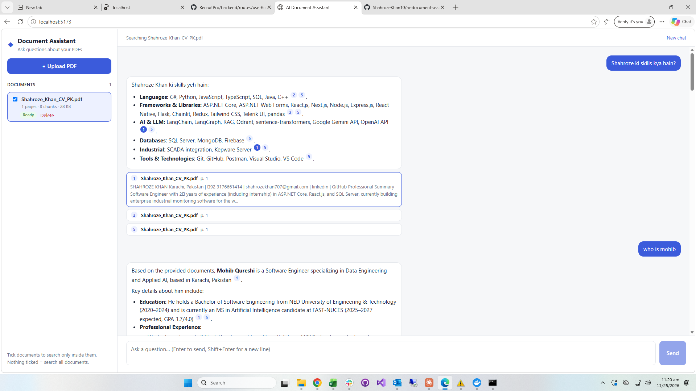
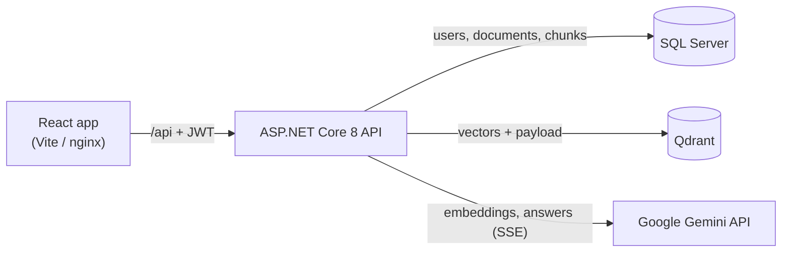

# AI Document Assistant

[](https://github.com/ShahrozeKhan10/ai-document-assistant/actions/workflows/ci.yml)

Upload PDFs and ask questions about them. Answers are streamed as they are written and cite the file and page they came from.

**ASP.NET Core 8** · **EF Core + SQL Server** · **Qdrant** (vector search) · **Google Gemini** (embeddings + generation) · **React 18 + TypeScript** · **JWT auth** · **Docker Compose** · **GitHub Actions**



## Features

- **PDF ingestion:** text is extracted page by page and split into overlapping chunks that end at sentence or word boundaries.
- **Retrieval-augmented answers:** chunks are embedded with Gemini, stored in Qdrant, and the closest ones are given to the model as numbered sources.
- **Grounded citations:** the model must answer only from the sources and cite them like `[1]`. Only the sources it actually cites are returned, and each citation in the UI opens the source text, file and page.
- **Streaming:** answers arrive piece by piece over Server-Sent Events, with a Stop button.
- **Accounts:** register and log in with JWT. Every user sees and searches only their own documents.
- **Tested and containerized:** xUnit tests, CI on every push, and the whole stack runs with one `docker compose` command.

## Architecture



**Upload:** PDF → PdfPig text per page → `TextChunker` (~1000 chars, 200 overlap) → `gemini-embedding-001` (768 dims, `RETRIEVAL_DOCUMENT`) → Qdrant points with `document_id`, page, file name and text → document and chunks saved in SQL Server.

**Question:** limit the search to the user's own ready documents → embed the question (`RETRIEVAL_QUERY`) → Qdrant cosine search, top 5 → prompt Gemini with numbered sources → stream the answer → return the cited sources.

## Project structure

```
src/DocAssistant.Api/
├── Controllers/        AuthController, DocumentsController, ChatController (HTTP only)
├── Services/           DocumentService (ingestion), RagService (scope → retrieve → generate → cite)
│   ├── Auth/           AuthService: PBKDF2 password hashing, JWT creation
│   ├── Ai/             GeminiClient: embeddings, generation and streaming over REST, retry on 429/5xx
│   └── VectorStore/    QdrantVectorStore: collection setup, upsert, filtered search, delete
├── Data/ Models/ DTOs/ Options/ Migrations/
└── Dockerfile

web/                    React 18 + TypeScript + Vite
├── src/api.ts          fetch with bearer token + a small SSE parser
├── src/components/     LoginPage, DocumentPanel, ChatPanel, MessageView (markdown + citations)
├── nginx.conf          serves the app and proxies /api (buffering off for streaming)
└── Dockerfile

tests/DocAssistant.Tests/   xUnit: TextChunker and RagService (with fakes for Gemini and Qdrant)
.github/workflows/ci.yml    build + test backend, type-check + build frontend, build Docker images
```

## Run with Docker (whole app)

Requirements: Docker Desktop and a free Gemini API key from [Google AI Studio](https://aistudio.google.com).

```bash
cp .env.example .env      # then fill in SA_PASSWORD, GEMINI_API_KEY and JWT_KEY
docker compose up -d --build
```

Open `http://localhost:3000`, create an account and upload a PDF. The API applies database migrations on startup.
On Windows, `docker-up.bat` creates `.env` for you and starts everything.

## Run locally (for development)

Requirements: .NET 8 SDK, SQL Server (Express/LocalDB is fine), Node.js 18+, Docker Desktop (for Qdrant).

```bash
docker compose up -d qdrant

cd src/DocAssistant.Api
dotnet user-secrets set "Gemini:ApiKey" "<your key>"
dotnet user-secrets set "Jwt:Key" "<any random string, 32+ characters>"
dotnet tool install --global dotnet-ef --version 8.0.11   # once
dotnet ef database update
dotnet run --launch-profile http        # Swagger: http://localhost:5080/swagger

cd ../../web
npm install
npm run dev                             # http://localhost:5173
```

Set `ConnectionStrings:Default` in `appsettings.json` for your SQL Server, for example `Server=.\\SQLEXPRESS;...`.
On Windows, `set-gemini-key.bat`, `setup-phase4.bat`, `run.bat` (API) and `web.bat` (web app) do these steps.

## Tests

```bash
dotnet test tests/DocAssistant.Tests/DocAssistant.Tests.csproj
```

- **TextChunker:** empty input, whitespace normalization, maximum chunk size, overlap between neighbours, sentence boundaries, text without spaces.
- **RagService:** returns only cited sources; never calls the model or vector store when the user has no documents; ignores requested document ids the user does not own; streams text pieces and then the sources.

## API

All endpoints except register and login need `Authorization: Bearer <token>`.

| Method | Route | What it does |
| --- | --- | --- |
| POST | `/api/auth/register` | Create an account: `{ "email": "...", "password": "..." }` → token |
| POST | `/api/auth/login` | Log in → token |
| GET | `/api/auth/me` | Current user |
| POST | `/api/documents` | Upload a PDF (form field `file`); it is chunked, embedded and indexed |
| GET | `/api/documents` | List your documents |
| GET | `/api/documents/{id}` | Document details |
| GET | `/api/documents/{id}/chunks` | Chunks the document was split into |
| POST | `/api/documents/{id}/reindex` | Re-create a document's embeddings |
| DELETE | `/api/documents/{id}` | Delete document, chunks, vectors and stored file |
| POST | `/api/chat` | Ask a question: `{ "question": "...", "documentIds": [], "topK": 5 }` |
| POST | `/api/chat/stream` | Same, streamed as Server-Sent Events: `delta`, `sources`, `error`, `done` |

## Design notes

- **No SDKs for Gemini or Qdrant:** both are called over REST with typed `HttpClient`s behind interfaces (`IEmbeddingService`, `IChatModel`, `IVectorStore`), which keeps every request visible and makes the RAG logic testable with fakes.
- **Different task types for documents and questions** improve retrieval quality with Gemini embeddings; 768 dimensions keep storage small with little quality loss.
- **Similarity scores alone can't tell relevant from irrelevant** (unrelated chunks still score ~0.55), so grounding is enforced in the prompt and by returning only cited sources.
- **Per-user isolation happens before retrieval:** the vector search is always filtered to the user's own document ids, and an empty scope never reaches Qdrant (an empty filter would mean "search everything").
- **Secrets stay out of the repo:** user-secrets locally, `.env` for Docker.
